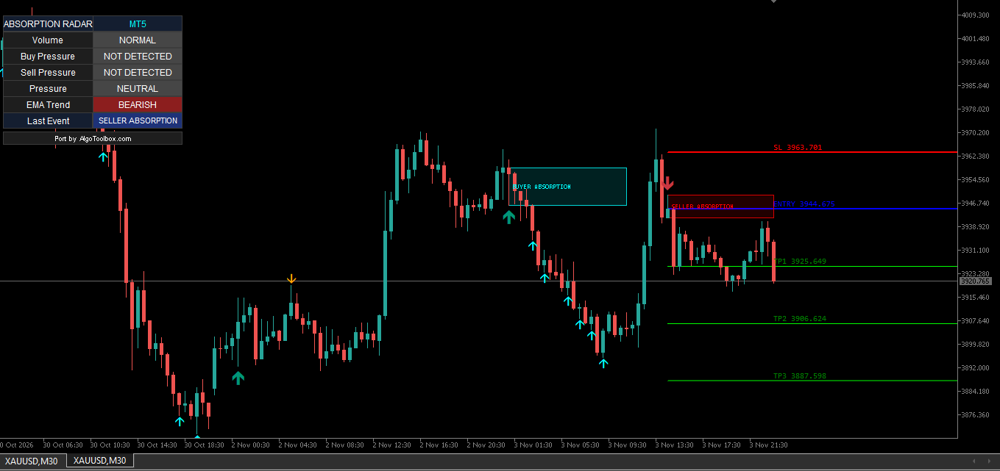

# Absorption Radar — MT5 Indicator

Open-source MT5 port of **Smart Money Absorption Radar [Thomas]**, by **Thomas-Sterling**. MT5 adaptation: **AlgoToolbox (atoskueko)**. Source version: **1.00**.

**[Full guide, settings and evaluation](https://algotoolbox.com/products/absorption-radar-mt5/)**

Highlights volume spikes with rejection wicks, draws buyer/seller absorption zones, and provides optional liquidity-sweep and EMA-trend filters, a signal cooldown, ATR-based reference targets and a radar dashboard.

**This is an indicator, not an EA.** It does not place, modify or close broker orders or size positions. Entry, SL and TP1–TP3 are chart reference levels, not executed trades.

## Install

1. In MT5, choose **File → Open Data Folder**.
2. Copy `src/AbsorptionRadar.mq5` into `MQL5/Indicators/`.
3. Open it in MetaEditor and press **F7** to compile; review errors and warnings.
4. Refresh **Navigator → Indicators** and attach it to a chart with sufficient history.

Start with defaults on a dark chart, one copy per chart. Alerts are off by default. Algo Trading is not required for analysis. Keep the filename if an EA uses it through `iCustom`.

This repository provides a source snapshot, not a validated binary release. No `.ex5` is included. Exact-source compilation, terminal validation and matched-data Pine/MT5 parity have not been established for this package. Read [KNOWN_ISSUES.md](KNOWN_ISSUES.md) before relying on its outputs.

## Read the outputs correctly

- **Check the volume feed.** `InpVolumeSource` defaults to tick volume. Selecting `SAR_REAL_VOLUME` on a symbol with no broker-provided real volume leaves the spike test unable to pass, so signals can disappear without an error. Use real volume only after confirming it is available.
- **Absorption is inferred from candle and volume conditions.** The display does not establish who traded or guarantee a reversal.
- **Reference levels persist until the next signal.** They are `0` before the first signal and are not broker-side protection.
- **The port is not an exact-parity claim.** EMA/ATR seeding, shared cooldown, fixed rejection thresholds and live-bar display behavior differ; see [porting notes](docs/porting-notes.md).

Use the **[AlgoToolbox guide](https://algotoolbox.com/products/absorption-radar-mt5/)** as the primary manual. This repository is a slim source mirror rather than a duplicate of the article.

## Developer reference

- [Inputs](docs/inputs.md)
- [Buffer map and iCustom example](docs/buffers.md)
- [Implementation differences](docs/porting-notes.md)

Buffers 0–9 expose EMA, Buy, Sell, BullSweep, BearSweep, Entry, SL and TP1–TP3 respectively. Consult the buffer documentation for value semantics before connecting an EA; do not assume every nonzero buffer value is a new entry event.

## License and attribution

Original work: **[Smart Money Absorption Radar [Thomas]](https://www.tradingview.com/script/7XJBJBZH-Smart-Money-Absorption-Radar-Thomas/)**, © **Thomas-Sterling**.

MT5 adaptation: **AlgoToolbox (atoskueko)**.

Covered source and modifications are distributed under **MPL-2.0**. See [LICENSE](LICENSE) and [NOTICE.md](NOTICE.md). Preserve applicable notices and tell recipients how to obtain the corresponding covered source when distributing a compiled build. No affiliation with or endorsement by the original author is implied.

This is a chart-analysis tool, not a promise of returns. Test its behavior on your broker's data before using its outputs in live decisions.
